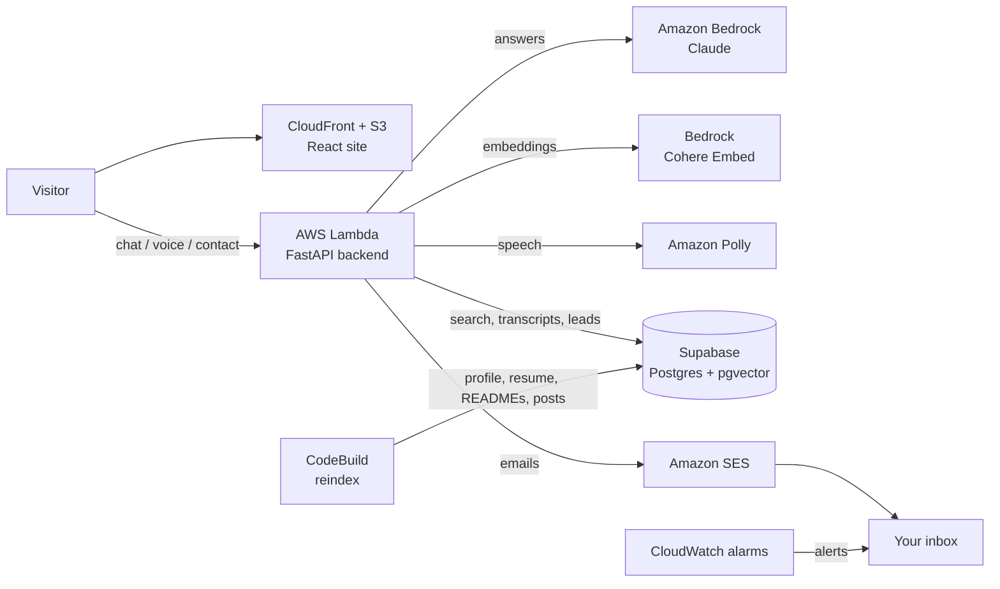

# Portfolio template with an AI assistant

A personal portfolio site with a built-in AI assistant that answers visitors' questions about you, by chat or by voice, and tells you when a recruiter has been in touch.

**Live:** [gautamportfolio.com](https://gautamportfolio.com/) · **License:** MIT, free to use for your own portfolio

---

## What it does

**The site**
- Projects, experience, education, certifications and a blog, in 7 languages (English, Hindi, Telugu, German, French, Japanese, Chinese)
- Dark and light themes, responsive, animated (Framer Motion)
- A resume download, a contact form, a command palette (`Ctrl+K`), and a small code-breaker game that unlocks a page for recruiters

**The AI assistant** (chat window on every page, plus a voice page)
- Answers from your own content: your profile and resume, your projects' GitHub READMEs, and your blog posts. When it doesn't know, it says so.
- Asks visitors whether they're a recruiter, a hiring manager or just exploring. For recruiters, it gathers their name, company, role and email during the conversation.
- **Voice agent** (English): one tap starts a hands-free conversation with natural-sounding speech.
- At the end, offers visitors a copy of the conversation by email.
- Emails you every conversation, with a lead summary on top (for example *Recruiter: Priya (Stripe), Backend Engineer II*).
- Never shares a phone number, and never commits you to locations, dates, salary or roles.

**For you**
- **Admin panel** (`/admin`): write and publish blog posts. They're added to the assistant's knowledge immediately.
- **Insights page** (`/admin/insights`): conversations and their transcripts, recruiter leads, contact messages, and daily counts.
- **Contact form:** messages arrive in your inbox, and senders get an automatic confirmation.
- **Analytics and monitoring:** Google Analytics 4 (no cookie banner, privacy-friendly defaults), CloudWatch alarms and a dashboard with per-stage response times.

---

## How it fits together



| Part | Tech |
|---|---|
| Frontend | React 18, Vite, Redux Toolkit, Tailwind CSS, Framer Motion, React Router, i18next, Recharts |
| Backend | Python 3.11, FastAPI on AWS Lambda (container image, Function URL), Mangum |
| AI | Amazon Bedrock: Claude for answers, Cohere Embed Multilingual v3 for search. Amazon Polly (generative voices) for speech. The browser's Web Speech API for listening. |
| Data | Supabase: Postgres with pgvector (knowledge index, conversations, leads, contact messages, blog posts) |
| Email | Amazon SES |
| Hosting and CI/CD | S3 + CloudFront + Route 53 + ACM, ECR, CodePipeline + CodeBuild |
| Observability | CloudWatch (alarms, dashboard, latency metrics), Google Analytics 4 |
| Tests | pytest (backend, offline), Playwright (browser, desktop and mobile) |

The backend calls AWS with its IAM role, so there are **no AI API keys** to manage.

---

## Use this template

You need **Node.js 20+**. The AI features also need **Python 3.11+**, an **AWS account** and a free **Supabase** project. The site works without the AI backend: the chat window just reports that it can't connect.

### 1. Copy the project

Click **Use this template** or **Fork** on GitHub, or:

```bash
git clone https://github.com/GautamaShastry/portfolio.git my-portfolio
cd my-portfolio
npm install
```

### 2. Put in your details

| File | What to change |
|---|---|
| **`site.config.js`** | Your name, pronouns, site URL, description, email, socials, Calendly link, resume file name. Used for page titles, meta tags, structured data, `robots.txt`, `sitemap.xml` and the assistant's UI text. |
| **`src/constants/index.js`** | Your content: intro, about, experience, education, projects (with GitHub links), certifications, skills, contact. The assistant learns from this. |
| **`public/resume.pdf`** | Your resume. It's offered for download, and the assistant reads it (phone numbers and emails are stripped first). |
| **`src/assets/projects/`** | Your photo and project images; they're referenced from `src/constants/index.js`. |
| **`public/g_letter.png`** | Your logo or favicon (or point `logo` in `site.config.js` at another file). |
| `src/i18n/locales/*.json` | Your `about.description` bio in each language. The assistant's UI text fills in your name automatically. If your pronouns differ from the defaults, also check the few gendered phrases in the non-English files. |
| `src/pages/SecretPage.jsx` | The recruiter page unlocked by the game, including its article link. |

### 3. Run the site

```bash
cp .env.example .env.local   # optional at this point
npm run dev                  # http://localhost:3001
```

### 4. Set up the AI assistant (optional)

1. **Supabase:** create a project, open **SQL Editor**, and run all of [`supabase/schema.sql`](supabase/schema.sql).
2. **Bedrock:** in the AWS console, open **Bedrock → Model catalog**:
   - Submit Anthropic's use-case form. It's needed once per account, and individuals can fill it in.
   - Make sure **Cohere Embed Multilingual v3** and a Claude model are available.
3. **SES:** verify your domain under **Identities**. Your account starts in sandbox mode, which only sends to verified addresses. Request **production access** so visitors receive confirmations.
4. **Backend settings:** `cp chatbot-backend/.env.example chatbot-backend/.env`, then fill in:
   - your owner details (`OWNER_NAME`, pronouns, `SITE_URL`);
   - your Supabase URL and service-role key;
   - an admin password hash and JWT secret (the generator commands are in the file);
   - your email addresses.

   Locally it uses your AWS credentials (`aws configure`).
5. **Run it:**
   ```bash
   cd chatbot-backend
   pip install -r requirements.txt
   python -m uvicorn main:app --port 8000
   ```
   Set `VITE_CHATBOT_API_URL=http://127.0.0.1:8000` in `.env.local`.
6. **Build the assistant's knowledge:** set `SUPABASE_URL`, `SUPABASE_SERVICE_ROLE_KEY` and `BEDROCK_REGION` in your shell or `.env`, then run `npm run reindex`.

---

## Configuration reference

**Frontend** (`.env` / `.env.local`; in production, CodeBuild environment variables)

| Variable | Purpose |
|---|---|
| `VITE_CHATBOT_API_URL` | Backend URL: the Lambda Function URL, or `http://127.0.0.1:8000` locally |
| `VITE_SUPABASE_URL`, `VITE_SUPABASE_ANON_KEY` | Public blog reads (safe to expose; access is limited by row-level security) |
| `VITE_GA_MEASUREMENT_ID` | Google Analytics 4 ID (`G-…`); leave empty to turn analytics off |
| `SUPABASE_URL`, `SUPABASE_SERVICE_ROLE_KEY`, `BEDROCK_REGION` | Used only by `npm run reindex` (never sent to the browser) |
| `GITHUB_TOKEN` | Optional, for the reindex: avoids GitHub's limit of 60 requests an hour |

**Backend** (`chatbot-backend/.env` locally; Lambda environment variables in production). Full list in [`chatbot-backend/.env.example`](chatbot-backend/.env.example).

| Variable | Purpose |
|---|---|
| `OWNER_NAME`, `OWNER_FIRST_NAME`, `OWNER_PRONOUNS`, `OWNER_LOCALIZED_NAMES`, `SITE_URL` | Who the portfolio belongs to (mirrors `site.config.js`) |
| `BEDROCK_CHAT_MODEL` | Claude model ID. IDs ending in `-v1:0` (e.g. Sonnet 4.5) use the classic Bedrock endpoint; newer IDs (e.g. `anthropic.claude-haiku-5-5`) use the Messages endpoint. See the note in `bedrock_client.py` about the SDK version. |
| `BEDROCK_EMBED_MODEL` | Default `cohere.embed-multilingual-v3` (1024 dimensions, matching the schema) |
| `POLLY_VOICE_EN` | English voice, default `Ruth` (generative engine) |
| `SUPABASE_URL`, `SUPABASE_SERVICE_ROLE_KEY` | Database (server-side only) |
| `ADMIN_PASSWORD_HASH`, `ADMIN_JWT_SECRET` | Admin login |
| `TRANSCRIPT_NOTIFY_EMAIL`, `TRANSCRIPT_SENDER_EMAIL`, `SES_REGION` | Where your emails go, and the verified sender |
| `ALLOWED_ORIGINS` | Optional CORS list; defaults to `SITE_URL`, its `www.` version, and local dev |

---

## Deploying to AWS

The repository includes both CI pipelines ([`buildspec.yml`](buildspec.yml) for the site, [`chatbot-backend/buildspec.yml`](chatbot-backend/buildspec.yml) for the backend). Both run the tests first and deploy only if everything passes.

**One-time setup**

1. **Site:** an S3 bucket (private) behind a CloudFront distribution, with an ACM certificate (in `us-east-1`) and Route 53 records for your domain and `www`.
2. **Backend:**
   - An ECR repository, and a Lambda function from a container image with a **Function URL** (auth: none; the app handles CORS).
   - Timeout **60 s**, memory **1024 MB**.
   - Attach [`chatbot-backend/bedrock-policy.json`](chatbot-backend/bedrock-policy.json) to its role (Bedrock, Polly, SES).
3. **Pipelines:** two CodePipelines, both watching your main branch, each with a CodeBuild project:
   - **Frontend:** `aws/codebuild/standard:7.0`. Set the frontend variables above, plus `S3_BUCKET` and `CLOUDFRONT_DISTRIBUTION_ID`. Store `SUPABASE_SERVICE_ROLE_KEY` as a Parameter Store `SecureString` under `/CodeBuild/portfolio/`, and attach [`scripts/reindex-policy.json`](scripts/reindex-policy.json) to the build role.
   - **Backend:** needs Docker, and the variables `AWS_ACCOUNT_ID`, `AWS_DEFAULT_REGION`, `IMAGE_REPO_NAME`, `IMAGE_TAG`, `LAMBDA_FUNCTION_NAME`.
4. **Transcript sweep:** create an EventBridge Scheduler schedule running every 15 minutes. Target the Lambda with the input `{"task": "send_pending_transcripts"}`. It emails conversations whose visitors left without closing the chat.
5. **Monitoring:**
   ```bash
   ALERT_EMAIL=you@example.com DISTRIBUTION_ID=E123EXAMPLE bash scripts/setup-monitoring.sh
   ```
   Then confirm the subscription email AWS sends you.

**Every deploy:** push to the main branch.
- **Backend pipeline:** runs its tests, then builds an image tagged with the commit (`git-<sha>`) and points the Lambda at it.
- **Frontend pipeline:** runs ESLint and the browser tests, then builds, uploads to S3, refreshes CloudFront and rebuilds the assistant's knowledge index.

**Rolling back**
- **Backend, instantly:** point the Lambda at an earlier image. ECR keeps the last 20 commit images.
  ```bash
  aws ecr describe-images --repository-name portfolio-chatbot --query "sort_by(imageDetails,&imagePushedAt)[-5:].imageTags"
  aws lambda update-function-code --function-name portfolio-chatbot     --image-uri <account>.dkr.ecr.<region>.amazonaws.com/portfolio-chatbot:git-<sha>
  ```
- **Anything:** `git revert <commit>` and push. The pipelines redeploy the previous version, tests included.

---

## Testing

```bash
npm run lint           # ESLint (also runs in CI)
npm run test:backend   # 61 backend tests (pytest): offline, about 3 s
npm run test:e2e       # 47 browser tests (Playwright) on desktop and mobile
```

- **Backend tests** replace Bedrock, Polly, SES and Supabase with fakes; any accidental real AWS call fails the test. They run as a fictional owner, so anything still hard-coded to the original owner shows up as a failure.
- **Browser tests** build the site and test the production build, with the backend faked and analytics blocked. Locally they use your installed Chrome; CI installs Playwright's Chromium.

---

## Monitoring and analytics

- **CloudWatch dashboard** `portfolio-overview`: requests, errors, response time, Claude calls and tokens (which drive cost), emails, website traffic and recent errors. Panels show where voice and chat time goes (search, Claude, speech).
- **Alarms (emailed to you):**
  - backend errors, Lambda crashes, throttling;
  - slow chat (over 15 s) or slow voice (over 12 s);
  - SES bounce rate;
  - website 5xx errors.
- **Google Analytics 4:**
  - Page views, plus the events `chatbot_opened`, `visitor_type_selected`, `chat_message_sent`, `voice_question_asked`, `voice_conversation_started`, `contact_form_submitted`, `resume_downloaded`, `conversation_copy_sent` and `assistant_response` (with `response_ms`).
  - Consent: analytics is on by default; visitors from the EU, EEA, UK and Switzerland stay cookieless; ad features are always off.
  - In GA, untick *Enhanced measurement → Page views → Page changes based on browser history events*. The site sends route changes itself.

---

## Project structure

```
├── site.config.js            # who the portfolio belongs to (edit first)
├── index.html                # page shell; %SITE.*% placeholders filled from site.config.js
├── src/
│   ├── constants/index.js    # your content (the assistant learns from it)
│   ├── components/           # sections, chat window, voice agent, admin pieces
│   ├── pages/                # routes, incl. admin/ (posts, insights)
│   ├── store/                # Redux slices
│   ├── i18n/locales/         # translations (7 languages)
│   └── lib/                  # analytics, chat session, Supabase client
├── public/                   # resume.pdf, logo
├── chatbot-backend/          # FastAPI app for Lambda: AI, voice, email, admin API, tests/
├── scripts/                  # reindex.mjs, setup-monitoring.sh, IAM policy
├── supabase/schema.sql       # database schema (safe to re-run)
├── e2e/                      # Playwright browser tests
├── buildspec.yml             # frontend CI/CD
└── chatbot-backend/buildspec.yml   # backend CI/CD
```

---

## Costs

Low traffic stays cheap. Approximate costs:
- **Claude Sonnet 4.5:** about $0.005–0.01 per chat answer, with prompt caching on the profile.
- **Polly generative voice:** about $0.01 per spoken answer.
- **Cohere embeddings and SES email:** fractions of a cent.
- **Lambda, Supabase and CloudFront:** within their free tiers at portfolio traffic.

**Caveat:** free Supabase projects pause after about a week without activity. The 15-minute transcript sweep keeps the database in use.

---

## Troubleshooting

| Problem | Fix |
|---|---|
| Dev server shows `504 Outdated Optimize Dep` | A sync tool (e.g. OneDrive) locked Vite's cache. The cache already lives in your temp folder; stop all dev servers and restart with `npm run dev -- --force`. |
| "Failed to fetch" from the chat window locally | Use `http://127.0.0.1:8000` rather than `localhost` (Windows may try IPv6 first), and make sure the backend is running. |
| Bedrock: "model use case details have not been submitted" | Submit Anthropic's use-case form under Bedrock → Model catalog. |
| Bedrock: a model "does not exist" or "isn't available" | Your account doesn't have that model yet: choose another `BEDROCK_CHAT_MODEL`. |
| Visitors don't receive confirmation emails | SES is still in sandbox mode: request production access. |
| The reindex skips READMEs | GitHub's anonymous limit (60 requests an hour) was reached: set `GITHUB_TOKEN`. Earlier README content is kept. |

---

## Author

Created by **Satya Bulusu**: [gautamportfolio.com](https://gautamportfolio.com/) · [LinkedIn](https://www.linkedin.com/in/satya2603/) · [GitHub](https://github.com/GautamaShastry/)

Licensed under the [MIT License](LICENSE). Use it, change it, make it yours. A star on the repo is appreciated.
